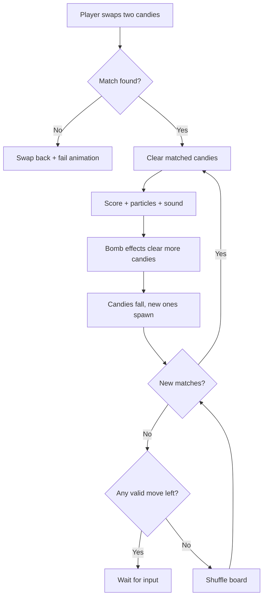
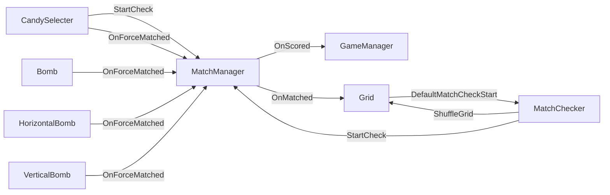

 <div align="center">

# 🍬 Match 3 — Unity

A timed Match-3 puzzle clone built in Unity 2023.2 (C#), featuring cascading matches, three kinds of bomb candies with chain reactions, automatic board reshuffling, and a data-driven candy system powered by ScriptableObjects.


https://github.com/user-attachments/assets/78b9298c-b297-4585-9b06-a5d276846c91


</div>

---

## 🎮 About

A from-scratch clone of the classic Match-3 puzzle. Swap neighboring candies to line up three or more of the same color. Matches disappear, candies fall, new ones drop in, and the board keeps checking itself for cascades. Score as much as you can before the timer runs out.

The project focuses on clean, readable gameplay code: candies are polymorphic (`Candy` base class with a `Matched()` override per type), systems communicate through static C# events, objects are recycled through an object pool, and every candy type is defined by a ScriptableObject.

## ✨ Features

- 👆 Click-to-swap controls: pick a candy, then pick a neighbor.
- 🔄 Failed swaps are reverted with a shake animation and sound.
- 🍭 Six candy colors with weighted random spawning.
- 💣 Three special candies with unique effects: Bomb, Horizontal Bomb, and Vertical Bomb.
- ⛓️ Chain reactions: bombs caught in a blast trigger their own effects.
- 🌊 Cascades: after every refill the board is re-checked for new matches automatically.
- 🛡️ Safe board generation that never creates a match on its own at start or refill.
- 🔀 Automatic shuffle when no valid move remains.
- ⏱️ Countdown timer with a game-over panel and retry button.
- 🏆 Current score and best score saved with `PlayerPrefs`.
- 💥 Colored explosion particles that match the cleared candy.
- 🎬 Fall and fail animations through the Animator and DOTween.
- ♻️ Generic object pool for candies, bombs, nodes, and particles.
- 📐 Camera auto-fit for different aspect ratios.

## 🕹️ Gameplay

### Controls

| Action | Input |
|---|---|
| Select a candy | Click it |
| Swap | Click an adjacent candy |

### Game Rules

1. Swap two neighboring candies. Diagonal swaps do nothing.
2. A swap must create a line of three or more matching candies (horizontal or vertical) for at least one of the two candies. Otherwise it is reverted.
3. Matched candies are removed, the candies above fall down, and new candies drop in from the top.
4. New matches created by falling candies are cleared automatically (cascades).
5. If no swap on the board can produce a match, the board is shuffled.
6. Each cleared candy awards 5–15 points.
7. When the timer ends, the game-over panel shows the final score and the best score.

### Special Candies

| Candy | Effect when matched |
|---|---|
| Bomb | Clears itself and all 8 surrounding candies. |
| Horizontal Bomb | Clears every candy in its row. |
| Vertical Bomb | Clears every candy in its column. |

Special candies work with these rules:

- A bomb next to a matched line is pulled into the match and detonates.
- Bombs cleared by another bomb's effect also detonate, which creates chain reactions.
- Swapping two bombs detonates both immediately.
- A bomb cannot be swapped with a regular candy.

### Spawn Rates

| Candy | Chance |
|---|---|
| Red, Blue, Green, Orange, Purple, Yellow | 15% each (90% total) |
| Bomb, Horizontal Bomb, Vertical Bomb | about 3.33% each (10% total) |

## 🧠 How It Works

### Game Loop



### Match Detection

Starting from a candy, the matcher flood-fills along one axis at a time (horizontal, then vertical), collecting neighbors of the same color.

A line of three or more is a match.

Bombs adjacent to the matched line are added to the match so they can detonate.

The matched nodes are queued and processed one batch at a time.

### Clearing and Refilling

- Each cleared candy awards points, plays a colored explosion, and calls its own `Matched()`.
- Bomb candies compute their blast area and raise a force-match event, which feeds the same queue.
- When the queue is empty, the affected columns are reported.
- For each affected column, remaining candies drop to the lowest empty cells.
- New candies spawn above the board and fall into the remaining gaps.
- The board is checked again for cascades.

### Valid Move Detection

After every cascade settles, the checker simulates each possible swap on the board: it swaps two neighbors in data only, runs the match check without side effects, and undoes the swap. If no swap produces a match, the grid is shuffled.

### Safe Generation

When picking a candy for a cell, the grid looks at the two cells to the left and the two below. If they are the same type, that type is banned for the new candy, so the board never starts with a ready-made match. The same check is used when refilling.

## 🏗️ Architecture

Systems communicate through static C# events and a few direct component references.

### Event Flow



### Events

| Event | Raised When |
|---|---|
| `MatchManager.OnForceMatched` | A set of nodes must be cleared regardless of color (bomb effects, bomb + bomb swap). |
| `MatchManager.OnMatched` | A batch of matches has been cleared. Carries the affected columns for refilling. |
| `GameManager.OnScored` | A candy is cleared and points are awarded. |

### Core Systems

| System | Responsibility |
|---|---|
| `GameManager` | `Idle` / `Play` state, countdown timer, score, best score and game-over panel. |
| `Grid` | Builds the board, spawns weighted random candies, handles gravity, refilling and shuffling. |
| `Node` | One grid cell: grid position, world position and the candy it holds. |
| `Candy` | Abstract base: initialization, movement, fall and fail animations. |
| `DefaultCandy` | Regular candy: clears itself and returns to the pool. |
| `Bomb` / `HorizontalBomb` / `VerticalBomb` | Special candies that compute their blast area and trigger a force match. |
| `CandyConfig` / `CandyData` | ScriptableObject and struct that define a candy type. |
| `CandySelecter` | Click input, swap validation, swap and revert logic. |
| `MatchManager` | Flood-fill match detection, match queue, scoring, particles and sounds. |
| `MatchChecker` | Cascade detection, valid-move simulation and reshuffle trigger. |
| `ObjectPool` | Named pools with automatic expansion. |
| `CameraFit` | Adjusts orthographic size to the screen aspect ratio. |

### Design Decisions

- **Polymorphic candies:** Each candy type overrides `Matched()`, so the match pipeline does not need to know which effect to run.
- **Event-driven chain reactions:** Bomb effects use the same queue as normal matches, so chain reactions need no special handling.
- **Data-driven candies:** Candy types, sprites, particle colors, spawn rates and pool names live in ScriptableObjects.
- **Weighted spawning:** Spawn probabilities are plain percentages on each config.
- **Match queue:** Matches are processed in batches with a short delay, so effects stay readable.
- **Side-effect-free checks:** The match check has a `doAction` flag, so the same logic powers real moves and valid-move simulation.
- **Object pooling:** Candies, bombs, nodes and explosion particles are reused.
- **Game state gate:** Input is ignored once the game state becomes `Idle`.
- **XML documentation:** Public methods carry summary comments.

## 📂 Project Structure

```text
Assets/
├── Resources/
│   └── Tiles/                 # Candy sprites, loaded by name
└── Scripts/
    ├── Core/
    │   ├── Candy/             # Candy, DefaultCandy, bombs, CandySelecter, CandyConfig
    │   │   └── CandyConfigs/  # Candy ScriptableObject assets
    │   ├── Grid/              # Grid and Node
    │   └── Managers/          # GameManager, MatchManager, MatchChecker
    │       └── Object Pool/   # ObjectPool, PooledObjectDisable
    └── Helpers/               # CameraFit, Singleton, list shuffle, menu loader
```

## 🚀 Getting Started

### Requirements

- Unity 2023.2.20f1
- TextMeshPro
- DOTween

### Installation

1. Clone the repository.
2. Open Unity Hub.
3. Select **Add → Add project from disk**.
4. Select the cloned project folder (use Unity 2023.2.20f1).
5. Import DOTween if it is not included in the repository.
6. Open the menu scene (build index `0`). It loads the game scene (build index `1`) automatically.
7. Press Play to start the game.

> Make sure both scenes are listed in **File → Build Settings** in this order: menu first, game second. The retry button also reloads scene index `1`.

## ⚙️ Configuration

### Grid

On the `Grid` component:

- **Grid Size:** Number of columns and rows.
- **Node Size:** Size of one cell.
- **Node Prefab / Candy Prefab:** Visuals for cells and candies.
- **Candy Configs:** The candy types that can spawn.

On the `GameManager`, set **Total Time** to change the round length in seconds.

### Candy Configuration

Create a `CandyConfig` asset (**Create → ScriptableObject → CandyData**) and set:

| Field | Meaning |
|---|---|
| `CandyType` | Identifier used for matching. Candies with the same type match each other. |
| `CandyResourceImage` | Sprite name inside `Resources/Tiles/`. |
| `CandyColor` | Color used for the explosion particles. |
| `Percent` | Spawn chance. Keep the total across all configs at 100. |
| `PoolName` | Which object pool provides the candy (`Candy`, `Bomb`, `HorizontalBomb`, `VerticalBomb`). |

### Required Pools

The `ObjectPool` needs these entries: `Node`, `Candy`, `Bomb`, `HorizontalBomb`, `VerticalBomb`, and `ExplosionParticle`.

### Adding a New Candy Color

1. Add the sprite to `Resources/Tiles/`.
2. Create a `CandyConfig` with a new `CandyType`, the `Candy` pool, and a spawn percentage.
3. Add it to the `Grid`'s candy config list and rebalance the percentages.

### Adding a New Special Candy

1. Create a class that extends `Candy` and implements `Matched()`.
2. Use `Grid` helpers to collect the nodes to clear, then raise `MatchManager.OnForceMatched`.
3. Create a prefab, add a pool entry, and create a `CandyConfig` for it.
4. Give it `CandyType` `Bomb` so swap and match rules treat it as a special candy.

## 🧰 Tech Stack

| Area | Tool |
|---|---|
| Engine | Unity 2023.2.20f1 |
| Language | C# |
| Rendering | 2D sprites, particle systems |
| Animation | DOTween, Animator |
| Input | Unity legacy Input Manager |
| UI | TextMeshPro |

